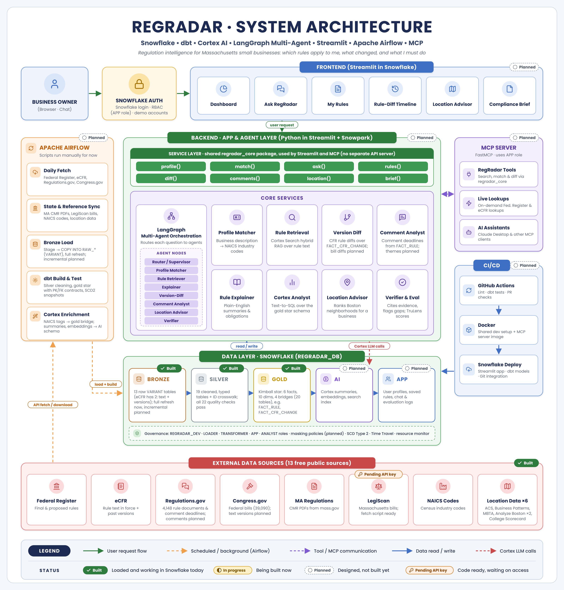
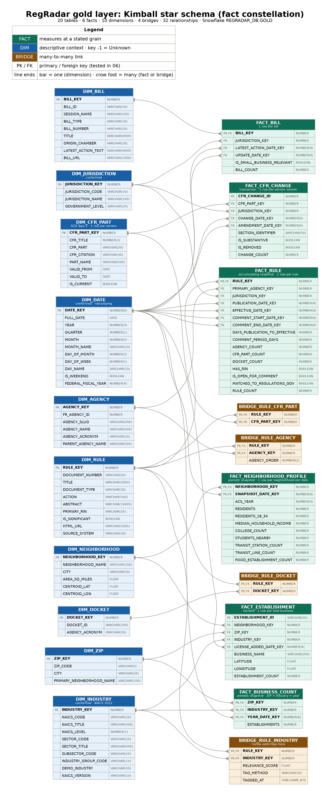

# 📡 RegRadar: Regulation and Location Intelligence for Small Businesses

> *"Which rules apply to my business, what's changing, and where should I open?"*

RegRadar helps small business owners in Massachusetts understand the regulations that affect them. A business owner describes their business ("I want to open a cafe near Northeastern"), and RegRadar:

- **Finds the rules that apply,** by matching the business to official industry codes (NAICS) and tagging every federal and state rule with the industries it affects.
- **Explains them in plain English,** with a checklist of what to do and by when, and a citation to the exact regulation.
- **Flags what's changing:** proposed rules open for public comment, upcoming deadlines, and rule text changes over time.
- **Compares locations,** ranking Boston neighborhoods on residents, students, transit, and existing competition for that type of business.

<<<<<<< Updated upstream
   ## 👥 Team

| Name | Role |
|---|---|
| Darshan | Data Engineer|
| Pranjal | System Architecture and AI Engineer |
| Shreya | App and DevOps  |
## Repository layout
| Folder | What goes in it |
=======
Big companies have legal teams to track regulations. A small restaurant, contractor, or shop doesn't. RegRadar is built for them.

> ⚠️ RegRadar is an academic research prototype. It is informational only and is not legal advice.

---

## 🏗️ Architecture



**Medallion layers in Snowflake (`REGRADAR_DB`):**

| Layer | What it holds | Status |
|---|---|---|
| **Bronze** | Raw records from every source, unchanged, as JSON (`PAYLOAD` VARIANT) with source file and load time | ✅ Built: 13 tables, 69,355 rows |
| **Silver** | Cleaned, typed, deduplicated tables; ID crosswalk across sources; every location assigned to a Boston neighborhood | ✅ Built: 19 tables |
| **Gold** | Kimball star schema (fact constellation): 6 facts, 10 dimensions, 4 bridges | ✅ Built: 20 tables |
| **AI** | Cortex industry tags, summaries, embeddings, search index | 🔜 Planned |
| **App** | User profiles, saved rules, chat and evaluation logs | 🔜 Planned |

---

## 📊 Data sources (all free and public)

| Source | What it provides | Records |
|---|---|---|
| Federal Register API | Final and proposed rules, all agencies, 2023 to today | 17,957 |
| eCFR API | Current rule text and version history for key CFR parts | 6 parts, 1,993 versions |
| Regulations.gov API | Rule documents, dockets, comment deadlines | 4,148 |
| Congress.gov API | Federal bills (118th and 119th Congress) | 39,090 |
| mass.gov | Massachusetts regulations (food code, minimum wage, earned sick time) | 3 |
| LegiScan API | Massachusetts bills | Pending API key |
| Census NAICS | Every US industry code | 2,125 |
| College Scorecard API | Massachusetts colleges, locations, enrollment | 140 |
| Census ACS 5-year (2024) | Residents, age, income by census tract | 235 tracts |
| Census County Business Patterns (2023) | Businesses by ZIP code and industry | 150 |
| MBTA V3 API | Rapid transit stations and lines | 125 |
| Analyze Boston | Neighborhood boundaries; active food establishment licenses | 26; 3,357 |

---

## 🧩 Data model

The gold layer is a **Kimball star schema**, organized as two stars that share conformed dimensions.

- **Regulation star:** `FACT_RULE` (accumulating snapshot), `FACT_CFR_CHANGE` (transaction), `FACT_BILL`
- **Location star:** `FACT_NEIGHBORHOOD_PROFILE` (periodic snapshot), `FACT_BUSINESS_COUNT` (periodic snapshot), `FACT_ESTABLISHMENT` (factless)
- **Shared dimensions:** `DIM_DATE` (role-playing), `DIM_INDUSTRY` (connects both stars), `DIM_JURISDICTION`
- **History:** `DIM_CFR_PART` is SCD Type 2, so RegRadar can answer "what did this rule say on a given date?"
- **Many-to-many:** bridge tables link each rule to its agencies, CFR parts, dockets, and industries



**Why Kimball, not Data Vault:** RegRadar's main job is answering questions quickly for an app and AI agents, from a fixed set of sources. Kimball serves that directly with fewer tables and simpler queries. History is covered by SCD Type 2 dimensions, and traceability by the bronze layer, which keeps every raw record with its source file and load time.

---

## 🛠️ Tech stack

| Area | Tools |
>>>>>>> Stashed changes
|---|---|
| Data collection | Python (`requests`, `pandas`, `pypdf`), Apache Airflow (planned) |
| Storage and compute | Snowflake: internal stages, `COPY INTO`, VARIANT, geospatial (`GEOGRAPHY`, `ST_CONTAINS`) |
| Modeling | SQL (silver and gold), Kimball star schema, dbt (planned) |
| AI | Snowflake Cortex: AI functions, embeddings, Cortex Search, Cortex Analyst (planned) |
| Agents and apps | LangGraph, Streamlit in Snowflake, MCP server (planned) |
| Modeling tools | Navicat (data model diagram) |
| Team | GitHub (pull request workflow), GitHub Actions (planned) |

---

## 📁 Repository structure

```
regradar/
├── ingestion/       Python scripts: fetch each source, validate, load to bronze
├── sql/             Snowflake setup, silver build, gold schema and load, checks
├── airflow/dags/    Scheduled pipeline (planned)
├── dbt/             dbt models and tests (planned)
├── agents/          LangGraph agents (planned)
├── app/             Streamlit app (planned)
├── mcp_servers/     MCP server (planned)
├── docs/images/     Diagrams and screenshots
└── tests/           Tests
```

---

## 🚀 Getting started

**Requirements:** Python 3.13, a Snowflake account, and free API keys from [api.data.gov](https://api.data.gov/signup) and the [Census Bureau](https://api.census.gov/data/key_signup.html).

```powershell
git clone https://github.com/Darshannn09/regradar.git
cd regradar
py -3.13 -m venv venv
.\venv\Scripts\Activate.ps1          # Mac: source venv/bin/activate
pip install -r requirements.txt
copy .env.example .env               # then fill in your keys
```

**1. Set up Snowflake (once):** run `sql/01_setup.sql` in Snowsight with Run All.

**2. Collect the data:** run the scripts in `ingestion/` in numbered order. Each saves files to `data/` (not committed to GitHub).

**3. Load bronze:**
```powershell
python ingestion/30_load_bronze.py
```

**4. Build silver and gold:** in Snowsight, run `sql/03_silver_build.sql`, `sql/04_gold_schema.sql`, and `sql/05_gold_load.sql`, each with Run All.

---

## 🔍 Data quality findings

- **100 duplicate rules** in the pilot load, because OSHA rules are also listed under the Department of Labor. Removed by `document_number`.
- **ID coverage:** 64% of rules have a RIN, 89% a docket ID, 99.9% a CFR reference. So sources are linked mainly by CFR part and docket ID.
- **93.4% of Regulations.gov documents** match a Federal Register rule through `frDocNum`.
- **8 malformed RINs,** including an OMB control number entered as a RIN.
- **492 CFR references point to a whole title or chapter** (`"part": null`). Found through a silver-to-gold row-count mismatch; excluded from part-level links and counted.
- **Census data cross-checks:** restaurant counts from Census business data and city food licenses agree at about 3 to 1 between Fenway and Jamaica Plain.

---

## 👥 Team

| Name | Role |
|---|---|
| *Name* | Data engineer |
| *Name* | Data modeler / analytics engineer |
| *Name* | AI engineer |
| *Name* | App and DevOps lead |

---

## 📄 License and data attribution

Code is released under the MIT License. Data comes from U.S. federal and Massachusetts government sources. Massachusetts bill data (when added) comes from LegiScan, licensed under [CC BY 4.0](https://creativecommons.org/licenses/by/4.0/).
